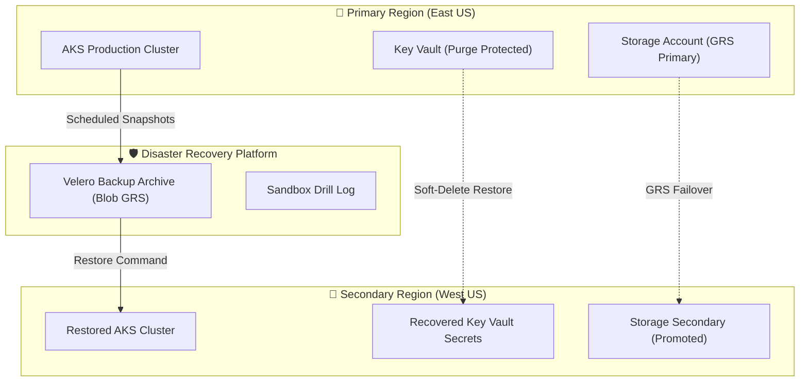

# Azure Disaster Recovery Runbooks & Automation

[](#)
[](https://github.com/sanjiivsingh/azure-dr-runbooks/actions)
[](https://opensource.org/licenses/MIT)

Sanitized, production-ready Disaster Recovery runbooks as code and markdown for Microsoft Azure: AKS state restoration with Velero, Key Vault soft-delete recovery, Geo-Redundant Storage failover, and sandbox drill logs.

---

## 🏛️ Disaster Recovery Overview



---

## 🌟 Runbooks Included

1. [AKS Disaster Recovery & Velero Restoration](runbooks/aks-backup-restore.md) (`scripts/aks_velero_dr.sh`): Full cluster and persistent volume restoration.
2. [Key Vault Soft-Delete Recovery](runbooks/keyvault-purge-protection-recovery.md) (`scripts/keyvault_recover.sh`): Cryptographic material restoration following accidental deletion.
3. [Azure Storage GRS Failover](runbooks/storage-account-failover.md) (`scripts/storage_failover.sh`): Geo-redundant storage failover validation and replication lag check.
4. [Sandbox Drill Log](drills/2026-sandbox-drill-log.md): End-to-end simulated drill log with verification outputs and teardown.

---

## 🚀 Usage & Execution

Ensure Azure CLI and kubectl are authenticated with appropriate subscription permissions:
```bash
# Clone the repository
git clone https://github.com/sanjiivsingh/azure-dr-runbooks.git
cd azure-dr-runbooks

# Make scripts executable
chmod +x scripts/*.sh

# Run Key Vault soft-delete recovery
./scripts/keyvault_recover.sh <vault-name> <region>

# Inspect storage replication status before failover
./scripts/storage_failover.sh <storage-account> <resource-group>
```

---

## 🔒 Security & Standards
See [SECURITY.md](SECURITY.md) and [ARCHITECTURE.md](docs/ARCHITECTURE.md).
