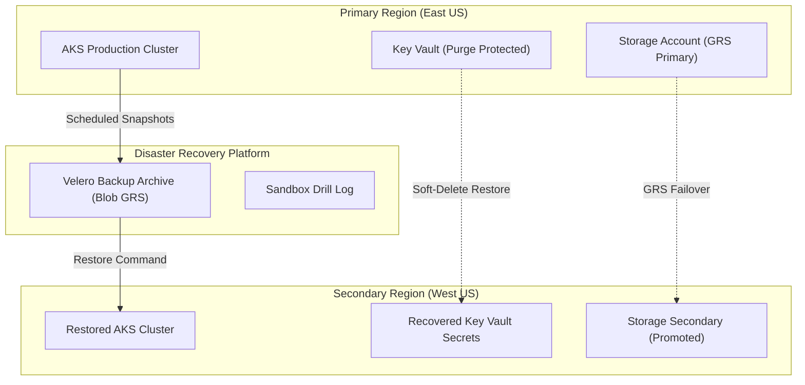

# 🛡️ Azure Disaster Recovery Runbooks & Automation

[](https://www.gnu.org/software/bash/)
[](https://learn.microsoft.com/en-us/cli/azure/)
[](https://github.com/sanjiivsingh/azure-dr-runbooks/actions)
[](https://github.com/sanjiivsingh/azure-dr-runbooks)
[](https://opensource.org/licenses/MIT)

> **Reference Architecture · Statically Validated**  
> Sanitized, production-ready Disaster Recovery runbooks as code and markdown for Microsoft Azure: AKS state restoration with Velero, Key Vault soft-delete recovery, Geo-Redundant Storage failover, and sandbox drill logs. Detailed verification logs are documented in [docs/EVIDENCE.md](docs/EVIDENCE.md) and architectural patterns in [docs/ARCHITECTURE.md](docs/ARCHITECTURE.md).

---

## 🏛️ Disaster Recovery Overview



---

## 🌟 Runbooks Included

1. [AKS Disaster Recovery & Velero Restoration](runbooks/aks-backup-restore.md) (`scripts/aks_velero_dr.sh`): Full cluster and persistent volume restoration.
2. [Key Vault Soft-Delete Recovery](runbooks/keyvault-purge-protection-recovery.md) (`scripts/keyvault_recover.sh`): Cryptographic material restoration following accidental deletion.
3. [Azure Storage GRS Failover](runbooks/storage-account-failover.md) (`scripts/storage_failover.sh`): Geo-redundant storage failover validation and replication lag check.
4. [Sandbox Drill Log](drills/2026-sandbox-drill-log.md): End-to-end simulated drill log with verification outputs and teardown.

---

## 🚀 Usage & Execution

Ensure Azure CLI and `kubectl` are authenticated with appropriate subscription permissions:

```bash
# Clone the repository
git clone https://github.com/sanjiivsingh/azure-dr-runbooks.git
cd azure-dr-runbooks

# Make scripts executable
chmod +x scripts/*.sh

# Run Key Vault soft-delete recovery
./scripts/keyvault_recover.sh <vault-name> <region>

# Inspect storage replication status before failover
./scripts/storage_failover.sh <storage-account> <resource-group>
```

---

## 👨‍💻 Author & Cloud Consultant

**Sanjeev Singh**  
Senior Azure Cloud Architect & DevSecOps Platform Engineer  
* 🌐 **Portfolio**: [sanjeevsingh.oneps.in](https://sanjeevsingh.oneps.in)  
* 💼 **LinkedIn**: [linkedin.com/in/sanjiivsingh](https://linkedin.com/in/sanjiivsingh)  
* 🐙 **GitHub**: [github.com/sanjiivsingh](https://github.com/sanjiivsingh)

---

## 📄 License
This project is open-source under the [MIT License](LICENSE).
